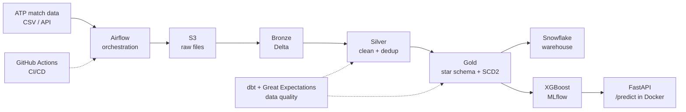

# TennisLake

End-to-end data engineering + ML pipeline on professional tennis data (ATP matches).
Raw match data is ingested, modeled into a lakehouse (bronze / silver / gold), tested, loaded into a warehouse, and used to train and serve a match-prediction model.

> Status: in progress (started Nov 2026)

## Architecture



## Tech stack

| Layer | Tools |
| --- | --- |
| Processing | PySpark, Databricks |
| Storage | Delta Lake, Parquet, AWS S3 |
| Orchestration | Apache Airflow |
| Transformations & tests | dbt, Great Expectations, pytest |
| Warehouse | Snowflake |
| ML | XGBoost, MLflow |
| Serving | FastAPI, Docker |
| CI/CD | GitHub Actions |

## Data model (gold)

- `fact_match`: one row per match (score, duration, stats, winner/loser keys)
- `dim_player`: SCD Type 2 (ranking, country tracked with `valid_from` / `valid_to`)
- `dim_tournament`: surface, level, location
- `dim_date`

## Repo structure

```
tennislake/
├── notebooks/        # Databricks notebooks (bronze, silver, gold)
├── src/              # reusable PySpark transformations
├── dags/             # Airflow DAGs
├── dbt/              # dbt project
├── api/              # FastAPI model service
├── tests/            # pytest
└── .github/workflows # CI
```

## Data source

ATP match data by Jeff Sackmann: https://github.com/JeffSackmann/tennis_atp (CC BY-NC-SA 4.0)
